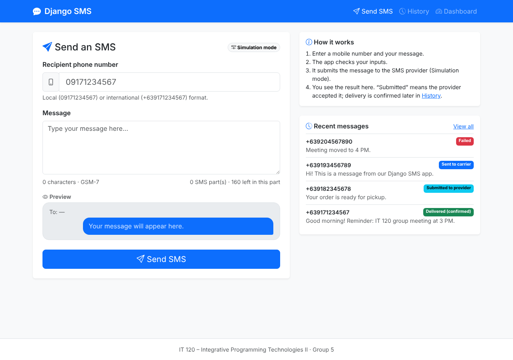
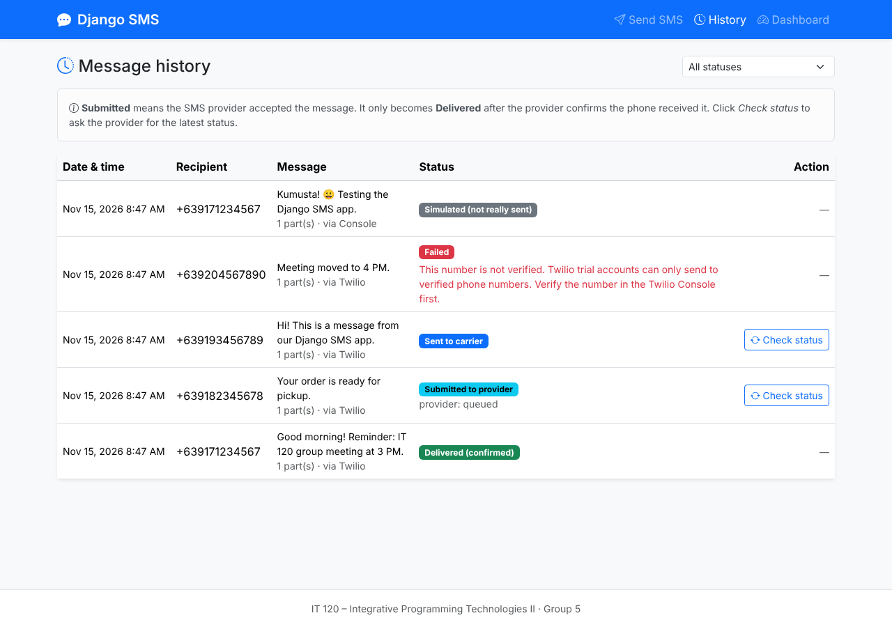
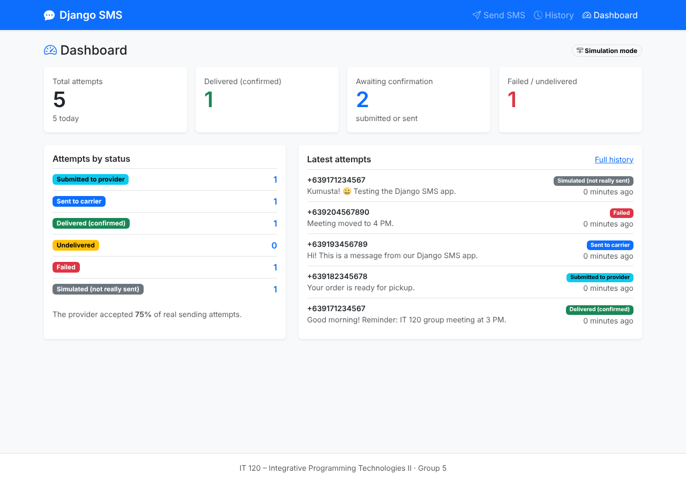

# Django SMS Sender

**IT 120 – Integrative Programming Technologies II · Group 5**

A Django web application that sends SMS messages through an SMS gateway API.
The user enters a recipient's mobile number and a message; the app validates
the input, submits the message to the configured SMS provider (Twilio or
Semaphore), and shows clear success or failure feedback. Every attempt is
saved so it can be tracked in a message history and a dashboard.

**Who it is for:** anyone who needs to send quick text messages from a web
browser, such as a small office sending reminders, or a school organisation
notifying members, without using their own phone.



---

## Table of contents

1. [Group members and responsibilities](#group-members-and-responsibilities)
2. [Main features](#main-features)
3. [SMS workflow](#sms-workflow)
4. [Technologies and dependencies](#technologies-and-dependencies)
5. [Project structure](#project-structure)
6. [Installation and setup](#installation-and-setup)
7. [Configuring the SMS provider](#configuring-the-sms-provider)
8. [Running the application](#running-the-application)
9. [Testing procedures and results](#testing-procedures-and-results)
10. [Security](#security)
11. [Known limitations](#known-limitations)

---

## Group members and responsibilities

| Member | Role | Main files |
|---|---|---|
| **Salubre, Ariel** | Django project setup, views, URLs and application logic | `sms_project/settings.py`, `sms_project/urls.py`, `sms_app/models.py`, `sms_app/views.py`, `sms_app/urls.py`, `sms_app/admin.py`, migrations |
| **Monoy, Hanz Rexis** | User interface, forms, validation and user feedback | `sms_app/forms.py`, `sms_app/templates/`, `sms_app/static/`, `sms_app/tests/test_forms.py` |
| **Silab, Ryan Jose** | SMS provider integration, testing, documentation and demonstration | `sms_app/services.py`, `sms_app/tests/test_services.py`, `sms_app/tests/test_views.py`, `README.md` |

All members reviewed the complete application and can explain how each part works.

---

## Main features

### Core features
- **SMS composition form** with a recipient phone number field, a message field and a *Send SMS* button.
- **Input validation** before anything is sent:
  - empty phone number or empty message (including a message of only spaces)
  - invalid characters, wrong number of digits, or landline numbers
  - message longer than 1,600 characters
- **Automatic phone number conversion.** Local Philippine numbers are converted to international (E.164) format, e.g. `0917 123 4567` → `+639171234567`.
- **SMS provider integration** through the provider's official API.
- **Error handling** with a clear message for each problem: missing or wrong API credentials, no internet or a timeout, an unverified number on a trial account, a provider rejecting the message, and more.
- **Honest status reporting.** A successful API call is shown as *Submitted*, not *Delivered*. A message is only marked *Delivered* when the provider confirms it.
- **Responsive Bootstrap 5 interface** that works on desktop and mobile.

### Additional features
| Feature | Where | Description |
|---|---|---|
| **Message history** | *History* page | Every attempt (successful or failed) with date, recipient, message, status and error reason. Filter by status; 10 per page. |
| **Message status tracking** | *History* → *Check status* | Asks the provider for the latest status (*Submitted → Sent to carrier → Delivered* or *Undelivered*). |
| **Dashboard** | *Dashboard* page | Totals for all attempts, delivered, awaiting confirmation and failed; attempts by status; provider acceptance rate; latest attempts. |
| **Character counter** | *Send SMS* page | Live count of characters and SMS parts. Detects Unicode (e.g. emoji), which lowers the limit from 160 to 70 characters per SMS. |
| **Message preview** | *Send SMS* page | Shows how the SMS will look and the number in international format before sending. |
| **Simulation mode** | `SMS_PROVIDER=console` | Develop and test without spending credits. Clearly labelled; it never claims a message was really sent. |
| **Multiple providers** | `.env` | Switch between Twilio, Semaphore and simulation mode without changing code. |

| History | Dashboard |
|---|---|
|  |  |

---

## SMS workflow

```
 User                     Django app                                  SMS provider
  │  1. Opens "/"           │                                              │
  │ ──────────────────────> │  compose view shows the empty SMSForm        │
  │  2. Enters number       │                                              │
  │  3. Types message       │                                              │
  │  4. Clicks Send (POST)  │                                              │
  │ ──────────────────────> │  5. SMSForm validates the inputs             │
  │                         │     ✗ invalid → form shown again with errors │
  │                         │     ✓ valid   → number converted to E.164    │
  │                         │  6. services.send_sms() ───────────────────> │ API request
  │                         │  <──────────────────── accepted / error ──── │
  │                         │  7. Attempt saved to the database            │
  │  8. Result message <─── │     Redirect back to the form                │
  │                         │                                              │
  │  9. "Check status" ───> │  services.refresh_status() ────────────────> │
  │  <── updated status ─── │  <───────────────── queued/sent/delivered ── │
```

| Step | What happens | Code |
|---|---|---|
| Recipient | The user types a number in local or international format. It is validated and converted to `+63…`. | `forms.py` → `normalize_phone_number()` |
| Message | The user types the message; the counter and preview update live. Spaces at both ends are trimmed. | `forms.py` → `SMSForm`, `static/sms_app/js/compose.js` |
| Sending | The view passes the clean data to the provider layer, which calls the Twilio or Semaphore API. | `views.py` → `compose()`, `services.py` → `send_sms()` |
| Feedback | A green, yellow or red alert explains the result. The page uses Post/Redirect/Get, so refreshing never sends twice. | `views.py`, `templates/sms_app/base.html` |
| Tracking | The attempt is saved; *Check status* updates it later. | `models.py` → `SMSMessage`, `views.py` → `check_status()` |

### Status meanings

| Status | Meaning |
|---|---|
| **Submitted to provider** | The provider accepted the request. Delivery is **not** confirmed yet. |
| **Sent to carrier** | The provider passed the message to the mobile network. Still not confirmed. |
| **Delivered (confirmed)** | The provider confirmed the phone received the message. |
| **Undelivered** | The carrier could not deliver it. |
| **Failed** | The request never reached the provider, or the provider rejected it. |
| **Simulated** | Simulation mode; nothing was sent. |

---

## Technologies and dependencies

| Technology | Purpose |
|---|---|
| Python 3.12+ | Programming language |
| Django 6.1 | Web framework (views, URL routing, forms, templates, ORM, CSRF protection, admin) |
| SQLite | Database for message history (Django's default) |
| Twilio Python SDK (`twilio`) | Calls the Twilio Programmable Messaging API |
| `requests` | Calls the Semaphore REST API |
| `python-dotenv` | Loads secrets from the `.env` file |
| Bootstrap 5.3 and Bootstrap Icons | Responsive user interface (loaded from a CDN) |
| HTML, CSS, JavaScript | Templates, custom styles, live character counter and preview |

All Python packages and exact versions are listed in [`requirements.txt`](requirements.txt)
(generated with `pip freeze > requirements.txt`). The other packages in that
file are installed automatically as dependencies of these. `tzdata` is
installed on Windows only, where Python needs it for time zones.

---

## Project structure

```
django-sms-group5/
├── manage.py
├── requirements.txt           # Python dependencies
├── .env.example               # Configuration template (placeholders only)
├── .gitignore                 # Excludes .env, venv, db.sqlite3, caches
├── README.md
├── docs/screenshots/          # Screenshots used in this README
├── sms_project/               # Django project
│   ├── settings.py            # Loads secrets from .env; SMS provider settings
│   ├── urls.py                # Root URLs: admin + sms_app
│   ├── asgi.py / wsgi.py
└── sms_app/                   # Django application
    ├── models.py              # SMSMessage: one row per sending attempt
    ├── forms.py               # SMSForm, phone number conversion, SMS part counting
    ├── services.py            # Twilio / Semaphore / simulation providers + error handling
    ├── views.py               # compose, history, check_status, dashboard
    ├── urls.py                # App URLs
    ├── admin.py               # SMS messages in the Django admin
    ├── migrations/
    ├── templates/sms_app/     # base, compose, history, dashboard (Bootstrap 5)
    ├── static/sms_app/        # css/style.css, js/compose.js
    └── tests/                 # test_forms.py, test_services.py, test_views.py
```

### Pages

| URL | Page |
|---|---|
| `/` | Send SMS form |
| `/history/` | Message history and status tracking |
| `/dashboard/` | Dashboard |
| `/admin/` | Django admin (optional; needs `python manage.py createsuperuser`) |

---

## Installation and setup

These steps are for **Windows** (Command Prompt). macOS/Linux commands are shown where they differ.

**Requirements:** Python 3.12 or newer, Git, and an internet connection.

```bat
:: 1. Get the code
git clone https://github.com/<owner>/django-sms-group5.git
cd django-sms-group5

:: 2. Create and activate a virtual environment
python -m venv venv
venv\Scripts\activate
:: macOS/Linux: source venv/bin/activate

:: 3. Install the dependencies
pip install -r requirements.txt

:: 4. Create your own configuration file from the template
copy .env.example .env
:: macOS/Linux: cp .env.example .env
```

5. **Generate a Django secret key** and paste it into `.env` as `DJANGO_SECRET_KEY`:

   ```bat
   python -c "from django.core.management.utils import get_random_secret_key as k; print(k())"
   ```

6. **Create the database tables:**

   ```bat
   python manage.py migrate
   ```

7. Choose and configure an SMS provider (next section). To try the app
   straight away without sending real SMS, keep `SMS_PROVIDER=console`.

### Environment variables (`.env`)

| Variable | Required | Description |
|---|---|---|
| `DJANGO_SECRET_KEY` | Yes | Django's secret key (step 5). |
| `DJANGO_DEBUG` | No | `True` for local development (needed to serve CSS/JS with `runserver`). |
| `DJANGO_ALLOWED_HOSTS` | No | Default `127.0.0.1,localhost`. |
| `SMS_PROVIDER` | Yes | `twilio`, `semaphore` or `console`. |
| `SMS_DEFAULT_COUNTRY_CODE` | No | Default `63` (Philippines), used to convert `09…` numbers. |
| `SMS_REQUEST_TIMEOUT` | No | Seconds to wait for the provider. Default `15`. |
| `TWILIO_ACCOUNT_SID` | Twilio | Account SID (starts with `AC`). |
| `TWILIO_AUTH_TOKEN` | Twilio | Auth Token. **Secret.** |
| `TWILIO_FROM_NUMBER` | Twilio | Your Twilio number in E.164 format, e.g. `+1…`. |
| `TWILIO_MESSAGING_SERVICE_SID` | No | Use a Messaging Service (`MG…`) instead of `TWILIO_FROM_NUMBER`. |
| `SEMAPHORE_API_KEY` | Semaphore | API key. **Secret.** |
| `SEMAPHORE_SENDER_NAME` | No | Your approved sender name. Blank = your account's default. |

> **Never commit `.env`.** It is already listed in `.gitignore`. Only
> `.env.example`, which contains placeholders, is in the repository.

---

## Configuring the SMS provider

Set `SMS_PROVIDER` in `.env` and fill in that provider's variables. Restart
the server after changing `.env`.

### Option A: Twilio

1. Sign up at <https://www.twilio.com/try-twilio> and verify your email and phone number.
2. In the **Twilio Console** home page, copy the **Account SID** and **Auth Token** into `.env`.
3. Get a Twilio phone number (Console → *Phone Numbers* → *Manage* → *Buy a number*) and put it in `TWILIO_FROM_NUMBER` in `+1XXXXXXXXXX` format.
4. **Trial accounts only:** add every test recipient under *Phone Numbers* → *Manage* → *Verified Caller IDs*. Trial accounts can only send to verified numbers (error 21608 otherwise).
5. Allow the destination country under *Messaging* → *Settings* → *Geo permissions* (e.g. tick **Philippines**); otherwise Twilio returns error 21408.
6. Set `SMS_PROVIDER=twilio`.

```env
SMS_PROVIDER=twilio
TWILIO_ACCOUNT_SID=ACxxxxxxxxxxxxxxxxxxxxxxxxxxxxxxxx
TWILIO_AUTH_TOKEN=your_auth_token_here
TWILIO_FROM_NUMBER=+15551234567
```

> **Philippine note:** as of November 2026, Twilio's trial program does not
> list the Philippines as a supported country, and sending to Philippine
> numbers requires a registered Sender ID. See [Known limitations](#known-limitations).

### Option B: Semaphore (Philippine SMS gateway)

1. Sign up at <https://semaphore.co> and load credits (each SMS costs one credit).
2. Copy your **API key** from the account page into `SEMAPHORE_API_KEY`.
3. Register a **Sender Name** (approval can take up to 5 business days) and put it in `SEMAPHORE_SENDER_NAME`, or leave it blank to use your default.
4. Set `SMS_PROVIDER=semaphore`.

```env
SMS_PROVIDER=semaphore
SEMAPHORE_API_KEY=your_semaphore_api_key_here
SEMAPHORE_SENDER_NAME=
```

Semaphore only sends to Philippine mobile numbers, and it ignores messages
that start with the word "TEST". The app warns about both before sending.

### Option C: Simulation mode (no account needed)

```env
SMS_PROVIDER=console
```

The message is printed in the server terminal instead of being sent. The app
shows a yellow warning that nothing was really sent.

---

## Running the application

```bat
venv\Scripts\activate
python manage.py runserver
```

Open <http://127.0.0.1:8000/> in your browser.

1. Enter the recipient's number (e.g. `09171234567`). On a Twilio trial it must be a verified number.
2. Type a message and watch the character counter and preview.
3. Click **Send SMS** and read the result message.
4. Open **History** and click **Check status** to see whether the provider confirmed delivery.
5. Open **Dashboard** for the summary.

Press `Ctrl+C` in the terminal to stop the server.

---

## Testing procedures and results

### 1. Automated tests

The app has **52 automated tests** that use mocked provider APIs, so they run
offline and never send a real SMS or need real credentials.

```bat
python manage.py test
```

```
Found 52 test(s).
...
Ran 52 tests in 0.1s

OK
```

| Test file | What it checks |
|---|---|
| `test_forms.py` (12) | Phone number conversion for 8 valid formats, 10 invalid numbers, empty fields, spaces-only message, message length, character and SMS part counting |
| `test_services.py` (20) | Twilio and Semaphore success, wrong credentials, invalid number, unverified trial number, unknown provider error, network error, timeout, missing configuration, status mapping, simulation mode |
| `test_views.py` (20) | Full page flows: form display, valid send, every validation error, credential errors not leaking secrets, network errors, no double-send on refresh, CSRF protection, HTML escaping, history filter, status check, dashboard totals |

### 2. Assignment test cases (Step 6)

| # | Test case | Input | Expected result | Result |
|---|---|---|---|---|
| 1 | Valid phone number and message | `09171234567`, "Hello" | Sends the SMS and shows the provider's response | ✅ Pass. Shows "Message submitted to the SMS provider. Delivery is not confirmed yet." |
| 2 | Empty phone number | *(blank)*, "Hello" | Rejected with a validation message | ✅ Pass. "Please enter the recipient's phone number." Nothing sent. |
| 3 | Empty message | `09171234567`, *(blank or spaces)* | Rejected with a validation message | ✅ Pass. "Please type a message. It cannot be empty or only spaces." |
| 4 | Invalid phone number | `0917-ABC`, `12345`, `0281234567` | Validation error | ✅ Pass. Field highlighted in red with a specific reason. |
| 5 | Incorrect or missing credentials | Wrong `TWILIO_AUTH_TOKEN` / empty `.env` values | Handled without exposing sensitive information | ✅ Pass. "The SMS provider rejected the app's credentials…" / "The SMS service is not configured…". No keys shown. |
| 6 | Provider or network error | No internet / provider error code | Understandable failure message | ✅ Pass. "Could not connect to the SMS provider. Please check your internet connection and try again." |
| 7 | Successful provider response | Provider returns `queued` | Confirms submission without claiming delivery | ✅ Pass. Saved as *Submitted*; becomes *Delivered* only after *Check status* returns `delivered`. |

### 3. Manual tests with the real provider

| Test | Result |
|---|---|
| SMS to a verified/authorised test number | _To be filled in by the group after testing with the real provider account (date, provider, status shown)._ |
| *Check status* after sending | _To be filled in._ |
| Unverified number (Twilio trial) | _To be filled in. Expected: error 21608 explained._ |
| Wrong Auth Token / API key | _To be filled in._ |
| Wi-Fi turned off while sending | _To be filled in. Expected: network error message._ |
| Mobile browser layout | ✅ Pass. Works at 390 px wide with no horizontal scrolling. |

---

## Security

- **Credentials are stored in environment variables** (`.env`, loaded with `python-dotenv`), never in the source code.
- **`.env` is excluded by `.gitignore`.** Only `.env.example` with placeholders is committed.
- **The Django `SECRET_KEY` also comes from `.env`.** The app refuses to start without one.
- **Errors never show secrets.** User messages are written by the app, not copied from the provider, and logs record only error codes, never keys or request URLs.
- **CSRF protection** (`` and `CsrfViewMiddleware`) on every form, including *Check status*.
- **Django's auto-escaping** prevents HTML/script injection in message text; the preview uses `textContent`.
- **Safe redirects:** *Check status* only redirects to local URLs.
- **State-changing actions use POST only**; the send button is disabled after one click to prevent double sending.
- **Authorised test recipients only**, following the provider's messaging policies.
- Bootstrap is loaded from a CDN with **Subresource Integrity** hashes.
- The demo video and screenshots do not show `.env`, the Auth Token or API keys.

---

## Known limitations

1. **Twilio and the Philippines.** As of November 2026, Twilio's trial program does not list the Philippines as a supported sign-up country, trial SMS is limited to the sign-up country, and trial accounts can only send Twilio's preset templates. Sending to Philippine numbers also requires a registered Sender ID (about 2 weeks to provision). Twilio delivery to Philippine phones may therefore not be possible on a trial account.
2. **Semaphore** sends only to Philippine numbers, costs about ₱0.56 per SMS, and reports *Sent* (handed to the network), not handset delivery, so Semaphore messages never show *Delivered*.
3. **Status updates are manual.** The app checks status when *Check status* is clicked. Automatic updates would need a provider webhook, which requires a public URL; the app runs on `localhost`.
4. **Single user, no login.** Anyone who can open the app can send SMS; a real deployment would need user accounts.
5. **One recipient per message.** Bulk sending and contact management are not included.
6. **Development server only.** The app is configured for local use with `runserver` and SQLite, not production hosting.
7. **Bootstrap loads from a CDN,** so the page looks unstyled without internet (sending SMS needs internet anyway).
